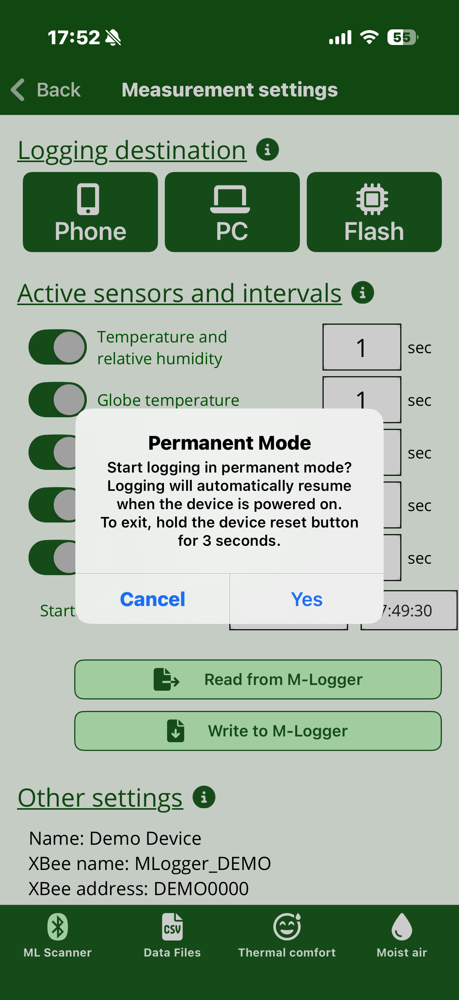
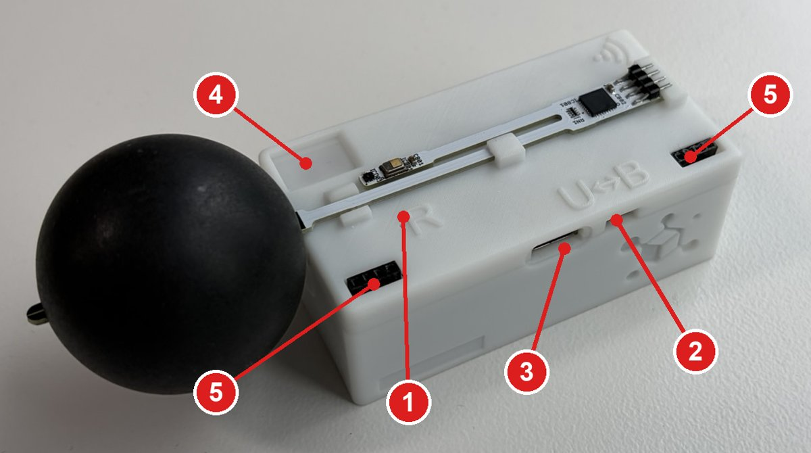
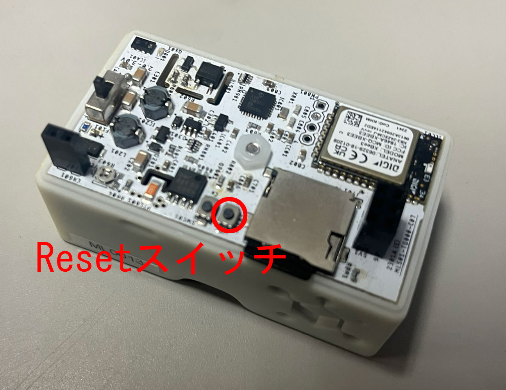

# Advanced settings and permanent mode

The items in this chapter are not used in normal measurement.
**Misconfiguring them may interfere with M-Logger operation.**

The three items "Correction coefficients" and "CO2 sensor calibration / initialization" only appear after you shake the smartphone on the [Measurement settings](settings.md) screen. The explicit shake gesture is the gate that protects them from accidental taps.

## Renaming the M-Logger

Use "Set M-Logger name" to change the display name shown in the scanner list.
Useful for distinguishing units when running several at once.

## Correction coefficients

Each unit is calibrated at the factory, so you normally do not need to touch this.
If you want to compensate for sensor drift after long-term use, the per-sensor gain and offset can be adjusted linearly.

On both v3 and v4 firmware, correction coefficients are set independently for the **five sensors** (drybulb temperature, relative humidity, globe temperature, illuminance, velocity — CO2 is excluded because it uses factory calibration + automatic self-calibration). Even though v4 collapses the measurement settings into 3 categories, correction coefficients remain per-sensor.

## CO2 concentration right after starting

If the CO2 sensor (Sensirion STCC4) has been powered off or not measuring for more than 3 hours, its readings can be off for a while after measurement resumes (datasheet §1.1.3 "Warm-Up"). About 1 hour of continuous measurement is needed for it to settle.

=== "Firmware 4.0.1 and later"

    **For the first hour after a measurement starts, CO2 is measured every second regardless of the recording interval, so the sensor warms up automatically.** No action is needed.
    Records are still stored at the interval you set. Battery consumption increases slightly for that hour only.

    Treat the CO2 concentration during roughly the first hour as approximate.

=== "Firmware 4.0.0 and earlier"

    For accurate CO2 measurement, run about 1 hour of continuous measurement first.

    1. Set the CO2 recording interval to **5 seconds or less** and measure for **about 1 hour** (CO2 is then measured every second continuously)
    2. Stop the measurement. You may also turn the M-Logger off
    3. Within **3 hours**, start the actual measurement with your intended settings (any recording interval, such as 10 minutes)

    As long as the sensor is not left unmeasured for more than 3 hours, it stays settled.
    If you skip this step, the readings can take a long time to settle, especially with long recording intervals.

See [Firmware versions and features](../start/firmware.md#how-to-check-the-version) for how to check the firmware version.

In addition, the probe conditions the sensor every time it starts (datasheet §3.4.9 `perform_conditioning`, about 22 seconds), so **CO2 concentration is blank for about 25 seconds after a measurement starts**. Dry-bulb temperature and humidity are blank as well (globe temperature is recorded). This short gap happens every time and is separate from the warm-up above.

## CO2 sensor calibration, reset, and full initialization

The CO2 sensor (Sensirion STCC4) has an **Automatic Self-Calibration (ASC)** feature: as long as it is exposed roughly once a day to fresh outdoor-equivalent air (about 400 ppm), it auto-calibrates against that level.
In normal indoor measurement — with daily ventilation, window opening, or carrying the device outdoors — ASC works without any special action.

For long-term measurement in continuously high CO2 environments (sealed rooms, greenhouses, experimental chambers, etc.) or when sensor output drift becomes noticeable, use one of the manual operations below. Each maps to a different command in the Sensirion datasheet (ICD01).

| Button | Operation | Duration | Datasheet |
|--------|-----------|---------|-----------|
| **Calibrate CO2 Sensor** | 30 s measurement + forced recalibration to the entered known concentration | ~35 s | §3.4.15 `perform_forced_recalibration` |
| **Factory Reset CO2 Sensor** | Erases ASC / FRC history and re-enables the bypass phase (returns the sensor to a fresh-out-of-the-box state) | ~90 ms | §3.4.11 `perform_factory_reset` |
| **Fully Initialize CO2 Sensor** | Factory reset → 12-hour stabilization run → forced recalibration (reproduces datasheet §1.1.4 "Initial Operation") | ~12 h | combination of the above |

### Calibrate CO2 Sensor

Place the sensor under a clearly known CO2 concentration, enter that value, and calibrate.

- The reference CO2 concentration should be a value verified with another calibrated CO2 meter or with a known reference gas
- The calibration operation takes about **35 seconds**. Keep the sensor and surrounding conditions (CO2 concentration, temperature, humidity, power) stable during that time

### Factory Reset CO2 Sensor

Clears the ASC / FRC history accumulated inside the sensor and returns it to the same state as a brand-new unit. Completes immediately (~90 ms).

Use this if sensor output is clearly wrong after long-term use (e.g. ASC has converged on an incorrect baseline). After the reset, the sensor re-enters the "Initial Operation" phase described in datasheet §1.1.4 and rebuilds accuracy through 12 hours of continuous operation combined with exposure to fresh air.

### Fully Initialize CO2 Sensor

Performs the **factory reset above + 12-hour continuous stabilization run + forced recalibration to the specified CO2 concentration**, all sequenced automatically by the app.
You don't have to wait 12 hours manually, but the M-Logger is occupied by this measurement during that time, so it cannot be used for other measurements. Run this only in an environment where the specified CO2 concentration (typically 400 ppm fresh air) can be maintained for the full duration.

## Communication with PC

Used for multi-unit operation with PC + Zigbee.
In this topology the PC + XBee coordinator is the **parent**, and each M-Logger is a **child**.
For the PC side, see [PC (MLServer)](../server/index.md).

## Switching to permanent mode

{ width="280" }

Selecting "Switch to permanent mode" configures the M-Logger so that it automatically starts measurement and sends data to the PC every time it is powered on.
This mode is intended for fixed installations on walls, ceilings, and the like.

!!! warning "Cannot be cancelled from the smartphone"
    Once in permanent mode, the M-Logger stays in permanent mode through any power cycle. You must use the physical Reset switch as described in the next section.

### Exiting permanent mode

Press and hold the Reset switch on the unit for 3 seconds or more; permanent mode is cancelled and the LED blinks three times.

=== "v4 firmware"

    The Reset switch is inside the small hole just to the left of the `R` mark on the top of the unit (1 in the photo below). See [Basic device operation](../start/device.md) for details.

    { width="500" }

=== "v3 firmware"

    { width="280" }
